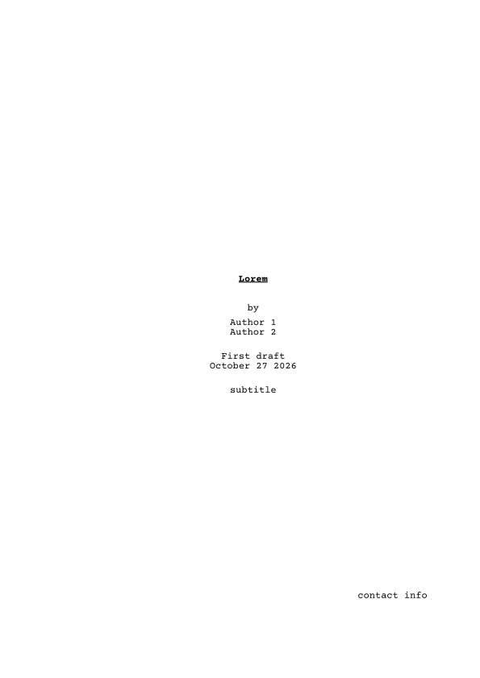
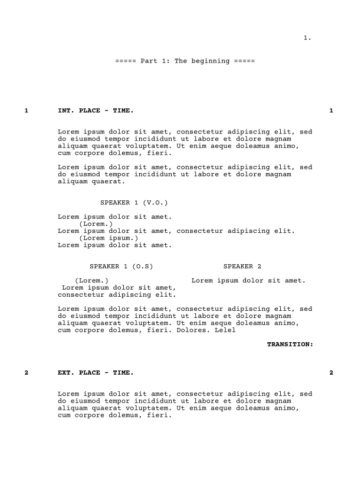

# ***Scriptie***

*Scriptie* formats your movie or tv script to the standard layout.
It has title pages, scene loglines, action, dialogue (with automatic _cont'd_ over page breaks!), parentheticals, transitions and more.

In addition, Scriptie optionally features a hackish abuse of Typst's syntax for a very efficient screenwriting experience.

# Demo
```typst
#import "@preview/scriptie:0.2.0":*
#show: qscript

#titlepage(
  title:[Your script],
  author:("You", "Your Cowriter"),
  version:"First draft",
  contact:"contact info",
  subtitle:"subtitle"
)

== INT. TYPST UNIVERSE - RIGHT NOW.

A curious Typst user is checking out the Scriptie package.

/ USER: (amazed) Wow! This is really great!

The user writes the best screenplay the world has ever seen.

/ PRODUCER: Ahh... but I don't want to produce good films.

/ USER (V.O.): Well, at least it was a joy to write.

- CUT TO

#lorem(30)

== EXT. The land of Lorem - DAY

#lorem(20)#parbreak()#lorem(35) 
/ #lorem(1): #lorem(10)
#lorem(15)
- THE END.
```



There's a demo showcasing all the functionalities [with the quick syntax](https://github.com/KauriP/scriptie/blob/a16bf15324099edc3df34ebfe5262ee2a6e0a3ae/demo-quick.typ)
and [without the quick syntax](https://github.com/KauriP/scriptie/blob/a16bf15324099edc3df34ebfe5262ee2a6e0a3ae/demo.typ).

# Numbering

Scene numbers, page numbers and part numbers are all shown by default.
Two options of `script` control them:

- `numbering` (default `true`): master switch. `false` turns off all numbering.
- `numbered` (default `(scene: true, page: true, part: true)`): turns individual kinds of numbering on or off. Only the keys you give are changed.

```typst
#show: script.with(numbering: false)              // no numbering at all
#show: script.with(numbered: (scene: false))      // page numbers only
#show: script.with(numbered: (page: false))       // scene numbers only
#show: script.with(numbered: (part: false))       // "===== Name =====" instead of "===== Part 1: Name ====="
```

`numbering: false` takes precedence over anything set in `numbered`.
The position of the numbers is set separately with `scene-numbering` (offsets of the left and right scene numbers; `none` hides that side) and `page-numbering` (offset of the page number; `none` hides it).

When using the quick syntax, pass the options to `qscript` instead, since it calls `script` itself:

```typst
#show: qscript.with(numbered: (scene: false))
```

Don't apply both `qscript` and `script` to the same document — the formatting would be applied twice, which causes errors such as `pagebreaks are not allowed inside of containers`.

# Dual dialogue

Two characters speaking at the same time can be placed side by side with `dual-dialogue`.
Each side is an ordinary dialogue, and the pair is kept together on one page.

```typst
#dual-dialogue(
  dialogue([Alice], "O.S.")[#pa[shouting] Get out of my kitchen!],
  dialogue([Bob])[No! I was here first.],
)
```

With the quick syntax, start two consecutive dialogue lines with `+`:

```typst
+ / ALICE (O.S.): (shouting) Get out of my kitchen!
+ / BOB: No! I was here first.
```

A `+` list with any other number of items is left as an ordinary numbered list.
`#dual-dialogue[/ ALICE: ...][/ BOB: ...]` also works with the quick syntax.

The indentation within each column is set with the `dual-indent` option of `script`.
Like `indent`, each entry is `(offset, width)`, measured from the left edge of the column; `gutter` is the space between the columns.
Only the keys you give are changed. The defaults are:

```typst
#show: script.with(dual-indent: (
  character: (0.75in, 1fr),
  parenthetical: (0.4in, 1fr),
  dialogue: (0in, 1fr),
  gutter: 0.3in,
))
```

# Possible issues

The preferred font to use with this package is [Courier Prime](https://quoteunquoteapps.com/courierprime/) or Courier.
For the web app, you should drop the `.ttf` files (unzipped from the linked download) into `Files`.

# Roadmap
- [x] Refactor all formatting into nice, non-hackish commands
  - [x] Dialogue
  - [x] Bring all configurable formatting into show command
- [x] Stabilise hackish version and use the nice commands
- [x] Add options for styling
  - [x] Which elements should be bolded
  - [x] Which elements should be UPPER CASE
  - [x] Which elements should be numbered
  - [x] Customise margins & other geometry
- [x] Implement side-by-side dialog
- [x] Implement
  - ```
    TEXT SIGNS
    IN SCRIPT
    ```
- [x] Implement raw pages with just typewriter input
- [x] Add translations
  - places
    - Contd
    - == Part N: XXX ==
    - titlepage by
    - titlepage date?
    - titlepage "Unnamed screenplay"
    - titlepage keywords?
  - [x] English
  - [x] Finnish
  - [x] Russian
- [ ] Write documentation for all functionality
- [x] Write examples you are allowed to share
- [x] Write packaging TOML
